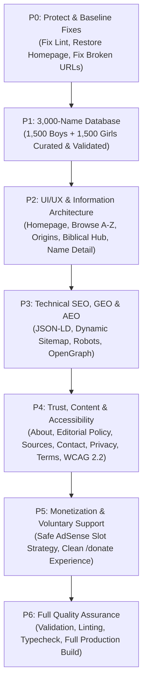

# Implementation Plan: Christian Names

**Project:** Christian Names Dictionary  
**Target:** 3,000-Name Database, Full Redesign, Technical SEO/GEO/AEO, Accessibility, AdSense & Voluntary Donations  
**Execution Sequence:** Phased P0 through P6  

---

## Phase Overview

---

## Detailed Phase Breakdown

### Phase P0: Baseline Fixes and Project Protection
1. **Fix ESLint Hook Violation in `DonationModal.tsx`:** Replace direct mutation of `window.location.href` with safe navigation method or assign.
2. **Restore and Design Homepage (`app/page.tsx`):** Replace accidental `TermsPage` with a comprehensive, editorial homepage.
3. **Sanitize Configuration and Environment Variables:** Fix malformed `NEXT_PUBLIC_DONATE_URL` and ensure graceful fallbacks.
4. **Safeguard Existing Working Components:** Retain the parchment/cloth visual aesthetic, Garamond typography, and Fuse.js search index pipeline.

### Phase P1: Build the 3,000 Distinct Name Database (1,500 Boys + 1,500 Girls)
1. **Schema Expansion:**
   - `slug`: unique URL-safe string
   - `name`: capitalized canonical headword
   - `gender`: `"boy"` | `"girl"`
   - `meaning`: precise, historical/etymological definition
   - `origin`: linguistic root (Hebrew, Greek, Latin, Aramaic, Old English, Celtic, Germanic, etc.)
   - `biblical`: boolean flag
   - `reference`: scripture citation (e.g., "Exodus 4:14", "Luke 1:13") or historical church context
   - `pronunciation`: phonetic or IPA guide
   - `variants`: array of spelling variants and cross-linguistic equivalents
   - `relatedNames`: array of related biblical/theological names
2. **Data Generation & Quality Controls:**
   - Preserve all 300 existing high-quality names.
   - Expand systematically to 1,500 boys' names and 1,500 girls' names.
   - Ensure authentic historical, biblical, and etymological integrity (no nonsense syllables or fake claims).
   - Strict normalization: lowercase trim comparison to guarantee 0 duplicate slugs or names.
   - Update `scripts/validate-data.mjs` to strictly enforce the 1,500 / 1,500 requirement and full schema compliance.
   - Run search index generator `scripts/build-search-index.mjs` to index the 3,000 names.

### Phase P2: Professional Visual Redesign & Information Architecture
1. **Homepage Experience (`/`):**
   - Refined hero section with clear editorial premise.
   - Instant search bar with keyboard shortcuts and auto-suggestions.
   - Quick-discovery filters: Boys, Girls, Biblical Names, Hebrew Origins, Greek Origins, Latin Origins.
   - Browse by Letter (A–Z interactive pill bar).
   - Curated Name Spotlights (Meaningful names of faith, grace, and strength).
   - Why Biblical & Christian Names Matter (educational guide).
   - Frequently Asked Questions (FAQ schema ready).
2. **Dedicated Discovery & Taxonomy Routes:**
   - `/christian-boy-names`: boys' dictionary with letter filtering and pagination/infinite list.
   - `/christian-girl-names`: girls' dictionary with letter filtering.
   - `/biblical-names`: dedicated collection of verified scripture-based names.
   - `/names/[letter]` (e.g. `/names/letter/a` or alphabetical hubs): crawlable letter directories.
   - `/origins/[origin]` (e.g. `/origins/hebrew`, `/origins/greek`, `/origins/latin`): rich linguistic hubs.
3. **Enhanced Individual Name Page (`/names/[slug]`):**
   - Clear typography hierarchy: Headword, pronunciation, grammatical classification, and origin.
   - Primary definition callout.
   - Comprehensive etymology and linguistic history.
   - Biblical reference block with exact scripture passage context.
   - Interactive Utilities: "Copy Link", "Copy Name", "Share" (Web Share API + fallback).
   - Curated cross-references and alphabetical previous/next links.

### Phase P3: Technical SEO, GEO, and AEO Foundations
1. **Crawlability & Static Generation:**
   - Ensure all 3,000 name pages and taxonomy hubs are prerendered via `generateStaticParams`.
2. **Metadata & OpenGraph:**
   - Dynamic, descriptive title tags: `[Name]: Meaning, Origin & Bible Reference | Christian Names`.
   - Concise meta descriptions optimized for search snippets.
   - Social cards with OpenGraph and Twitter tags.
3. **Structured Data (JSON-LD):**
   - Homepage: `WebSite` with `SearchAction` (`potentialAction`).
   - Category pages: `CollectionPage` and `BreadcrumbList`.
   - Individual name pages: `ItemPage`, `DefinedTerm` or `WebPage`, with accurate publisher metadata (no fake ratings or fake author claims).
4. **Sitemap & Robots:**
   - XML sitemap at `/sitemap.xml` dynamically including all static hubs and all 3,000 name URLs.
   - Clean `robots.txt` disallowing `/api/` and pointing to sitemap.

### Phase P4: Content Quality, Trust & Accessibility (WCAG 2.2 AA)
1. **Core Trust Pages:**
   - `/about`: Mission, audience, scope, non-commercial dedication.
   - `/editorial-policy`: Standards for name meanings, handling disputed origins, transliteration policy, and correction workflows.
   - `/sources`: Academic references, lexicons (Strong's Concordance, Gesenius, Thayer, Oxford Dictionaries of First Names), Bible translations.
   - `/contact`: Clean contact page with functional feedback instructions.
   - `/privacy-policy`: Comprehensive privacy, cookie disclosure, AdSense third-party policy.
   - `/terms`: Clear terms of use, content ownership, and disclaimers.
2. **Accessibility Audits & Enhancements:**
   - Keyboard accessible modals and dropdowns with escape key and focus traps.
   - High contrast text (`#261f18` on `#f6f0e0` exceeds 10:1 ratio; gold accents tuned for readability).
   - ARIA landmarks (`banner`, `main`, `navigation`, `contentinfo`, `search`).
   - Mobile-responsive navigation menu with clean touch targets (minimum 44×44px).

### Phase P5: Monetization & Voluntary Support Readiness
1. **Safe AdSense Integration:**
   - Isolate ad slot configuration; do not hardcode fake unit IDs (`0000000001`).
   - Guard `AdSlot` component so it only renders when real slot and publisher IDs are explicitly configured.
   - Maintain strict ad boundaries: never disguise ads as dictionary items, navigation, or definitions.
2. **Voluntary Donation Experience (`/donate`):**
   - Provide a dedicated `/donate` page explaining why the site is free and how donations help research and hosting.
   - Support direct configurable external links (e.g. Buy Me a Coffee, Ko-fi, PayPal) with sanitized URL validation.
   - Keep Stripe card donations optional, gracefully disabled when secrets are not supplied.

### Phase P6: Testing, Build Verification & Documentation
1. Run data validation script: confirm 1,500 boys + 1,500 girls = 3,000 unique names.
2. Run TypeScript compiler: `npx tsc --noEmit`.
3. Run ESLint: `npm run lint`.
4. Run full production build: `npm run build` with Turbopack.
5. Generate `docs/NAME_DATABASE_REPORT.md` and `docs/FINAL_IMPLEMENTATION_REPORT.md`.

