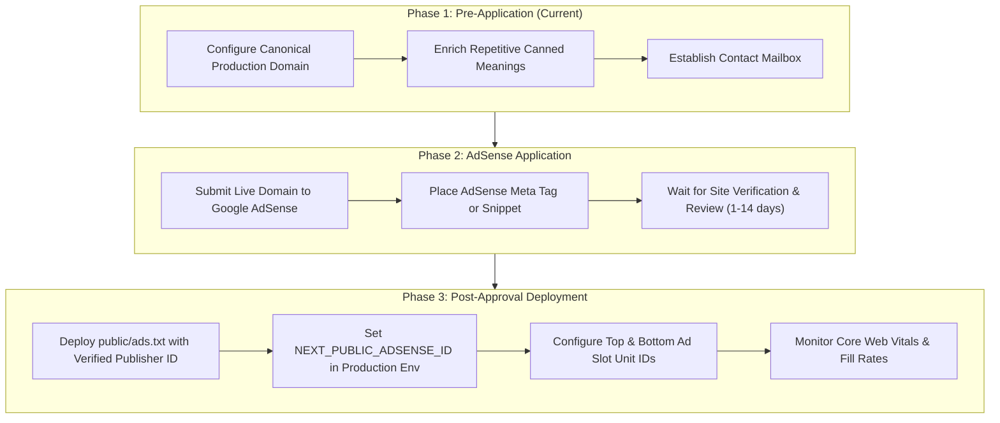

# Phase 2 Google AdSense Readiness & Voluntary Donation Audit Checklist

**Project:** Christian Names Dictionary (`christian-names`)  
**Focus:** Commercial Compliance, Policy Alignment, Ad Placement Safety, Voluntary Monetization  
**Guidelines:** Google AdSense Program Policies, Better Ads Standards, Financial Compliance Transparency  

---

## 1. Google AdSense Readiness Audit

### A. Policy Compliance Assessment

| AdSense Policy Requirement | Current Implementation Status | Compliance Assessment |
| :--- | :--- | :--- |
| **Valuable Inventory / Original Content** | 3,000 scholarly entries, 1,623 biblical scripture citations, 25 origin hubs, 26 alphabetical hubs. | **MODERATE RISK**: 1,143 records contain repetitive boilerplate meanings. Editorial enhancement is recommended prior to application to avoid "Low value content" rejection. |
| **Navigation & User Experience** | Clean typography, mobile-responsive hamburger drawer, sticky header, clear breadcrumbs, zero popups or forced redirects. | **COMPLIANT**: Clean, readable, user-centric editorial layout. |
| **Ad Placement & Deceptive Formatting** | Ad units are encapsulated in `<aside aria-label="Advertisement">` with clear separation from editorial content. | **COMPLIANT**: No ads disguised as navigation or buttons. |
| **Site Under Construction** | Full website compiles into 3,072 static HTML pages. Complete legal pages (About, Editorial Policy, Sources, Contact, Privacy, Terms). | **COMPLIANT**: Fully built, zero 404 dead ends on main navigation. |
| **Privacy Policy & Cookie Disclosures** | Detailed Privacy Policy at `/privacy-policy` detailing Google AdSense third-party cookie usage, log files, and opt-out links. | **COMPLIANT**: Explicitly addresses third-party vendor advertising. |

---

## 2. AdSlot Component Gating & Safety Controls

The application implements strict programmatic gating in `components/AdSlot.tsx` and `app/layout.tsx`:

1. **Client Script Suppression:**
   ```tsx
   // app/layout.tsx
   {ADSENSE_ID && (
     <Script
       async
       strategy="afterInteractive"
       src={`https://pagead2.googlesyndication.com/pagead/js/adsbygoogle.js?client=${ADSENSE_ID}`}
       crossOrigin="anonymous"
     />
   )}
   ```
   If `NEXT_PUBLIC_ADSENSE_ID` is empty or undefined, zero Google tracking or script tags are loaded.
2. **Dummy Slot Rejection:**
   ```tsx
   // components/AdSlot.tsx
   const isValidSlot = slot && !/^0+$/.test(slot.replace(/[^0-9]/g, "")) && slot.length > 5;
   const isEnabled = adsenseId && adsenseId.startsWith("ca-pub-") && isValidSlot;
   if (!isEnabled) return null;
   ```
   If slot IDs are placeholders (e.g. `0000000001`) or the publisher ID does not start with `ca-pub-`, the component returns `null`, preventing empty white boxes, console errors, or layout shift during development.

---

## 3. The `ads.txt` Specification & Setup Guide

Google requires an authorized digital sellers (`ads.txt`) file placed at the root of the domain:

### When to Create `public/ads.txt`:
Do **not** create a fake `public/ads.txt` before acquiring a legitimate publisher ID from Google AdSense. Creating a dummy file can cause crawling errors during review.

### Exact Format Required Upon Approval:
```text
google.com, pub-XXXXXXXXXXXXXXXX, DIRECT, f08c47fec0942fa0
```
*(Replace `pub-XXXXXXXXXXXXXXXX` with your verified 16-digit AdSense Publisher ID).*

---

## 4. Step-by-Step 3-Phase Monetization Roadmap



---

## 5. Voluntary Donation Infrastructure Audit

### A. Buy Me a Coffee Integration
- **Configuration:** `process.env.NEXT_PUBLIC_DONATE_URL` is set to `https://buymeacoffee.com/TaimoorJutt`.
- **Validation:** `lib/utils.ts` sanitizes the URL ensuring valid HTTPS protocol.
- **Visual Integration:**
  - Distinct CTA button on `/donate` page.
  - Direct link inside `components/DonationModal.tsx`.
  - Accessible from the global header ("Support Us") and footer.

### B. Stripe Card Donation Graceful Degradation
- **Endpoint:** `app/api/donate/route.ts` handles Stripe session creation.
- **Graceful Behavior:** Since `STRIPE_SECRET_KEY` is currently unconfigured, the endpoint returns:
  ```json
  { "error": "Card donations are not set up yet." }
  ```
  with HTTP status `501 Not Implemented`.
- **Modal Feedback:** `components/DonationModal.tsx` intercepts status 501 and gracefully informs the visitor:
  *"Card donations are not configured yet. Please consider supporting via Buy Me a Coffee."*
  with the direct Buy Me a Coffee button immediately accessible below.

### C. Legal & Financial Compliance Disclaimers
1. **No False Charity Claims:** Clear notices across `/donate` and `DonationModal.tsx` specifying:
   *"Voluntary contributions are non-tax-deductible personal gifts made directly to our maintenance team. We make no claims of registered non-profit or tax-exempt charitable status."*
2. **Zero Paywalls:** Reaffirms that the dictionary is 100% free and voluntary support never restricts content access.
3. **Accessibility:** Modal implements `role="dialog"`, `aria-modal="true"`, `aria-labelledby="donate-title"`, Escape key dismissal, and backdrop click dismissal.

